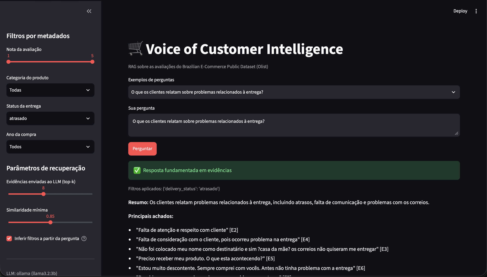
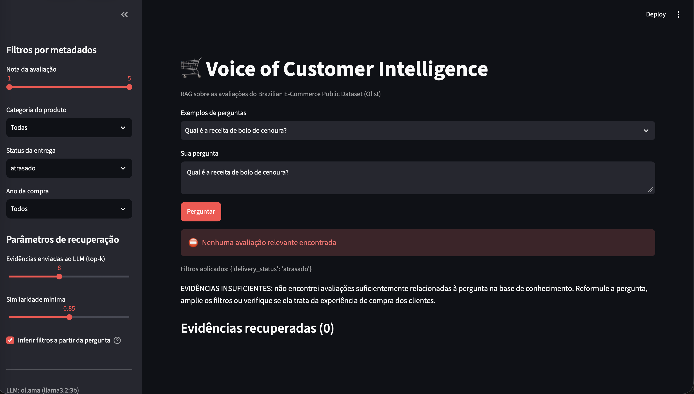

# Voice of Customer Intelligence com RAG – Olist

Solução de **Retrieval-Augmented Generation (RAG)** que transforma ~100 mil avaliações de clientes do
[Brazilian E-Commerce Public Dataset (Olist)](https://www.kaggle.com/datasets/olistbr/brazilian-ecommerce)
em uma base de conhecimento consultável em linguagem natural, com **respostas fundamentadas em evidências
rastreáveis** e **reconhecimento de quando não há informação suficiente**.

> Tech Challenge – Fase 4 · Pós-Graduação AI Scientist FIAP
> Helena Simões

---

## 1. Problema de negócio

Empresas de e-commerce recebem milhares de avaliações por dia. A nota (1–5) mostra *quanto* o cliente está
satisfeito, mas o *porquê* está no texto livre — e ler milhares de comentários manualmente não escala.

O objetivo é permitir que gestores perguntem, por exemplo:

- *Quais são os principais problemas relatados pelos clientes?*
- *O que os clientes relatam sobre problemas de entrega?*
- *O que os clientes mais elogiam?*

…e recebam respostas **sustentadas por avaliações reais**, com a possibilidade de conferir cada evidência.

## 2. Arquitetura

```
Pergunta
   │
   ▼
query_processing ── normaliza o texto e infere filtros ("insatisfeitos" → nota ≤ 2)
   │
   ▼
retriever ───────── embedding e5 ("query: …") → ChromaDB (40 candidatos + filtros de metadados)
   │                → limiar de similaridade (0,84) → MMR (8 evidências diversas)
   ▼
guardrails ──────── 0 evidências → resposta padrão, sem LLM
   │                < 3 evidências → lista as avaliações, sem concluir
   ▼
prompts ─────────── contexto numerado [E1]…[E8] com metadados + regras de fundamentação
   │
   ▼
llm ─────────────── Ollama (llama3.2:3b, local) ou Claude (API Anthropic)
   │
   ▼
rag_pipeline ────── detecta "EVIDÊNCIAS INSUFICIENTES" e valida as citações [E#]
   │
   ▼
Resposta + evidências rastreáveis (review_id, nota, categoria, entrega, período)
```

| Módulo | Responsabilidade |
|---|---|
| `src/config.py` | Caminhos e hiperparâmetros (ajustáveis pelo `.env`) |
| `src/data_preparation.py` | Carga, limpeza, tratamento de ausentes e criação dos documentos |
| `src/indexing.py` | Embeddings e indexação no ChromaDB |
| `src/query_processing.py` | Normalização da pergunta e inferência de filtros |
| `src/retriever.py` | Busca semântica, limiar de similaridade e MMR |
| `src/prompts.py` | Prompt do sistema e montagem do contexto |
| `src/llm.py` | Clientes Ollama e Claude com interface comum |
| `src/rag_pipeline.py` | Orquestração do fluxo e guardrails (também roda via terminal) |
| `app/streamlit_app.py` | Interface web de demonstração |
| `scripts/evaluate.py` | Avaliação da recuperação e das respostas |

## 3. Tecnologias

| Tecnologia | Uso |
|---|---|
| Python 3.14 | Linguagem |
| pandas / pyarrow | Preparação dos dados e armazenamento em Parquet |
| sentence-transformers (`intfloat/multilingual-e5-small`) | Embeddings |
| ChromaDB | Banco vetorial persistente com filtros por metadados |
| Ollama (`llama3.2:3b`) | LLM local e gratuito (padrão) |
| Anthropic SDK (Claude) | LLM alternativo via API |
| Streamlit | Interface |
| pytest | 27 testes automatizados |

## 4. Preparação da base de conhecimento

### 4.1 Seleção dos dados
Foram usados 4 dos 9 arquivos do dataset: avaliações (texto e nota), pedidos (datas de compra, entrega e
prazo estimado), itens e produtos (categoria). Os demais (clientes, vendedores, pagamentos, geolocalização)
não acrescentam contexto relevante às perguntas sobre a experiência relatada.

### 4.2 Funil de preparação

| Etapa | Registros |
|---|---:|
| Avaliações brutas | 99.224 |
| Após remover `review_id` duplicados (814) | 98.410 |
| Com algum texto (título ou mensagem) | 42.370 |
| Com texto informativo (≥ 10 caracteres e com letras) | **38.641** |

### 4.3 Decisões e justificativas

- **Valores ausentes:** 58,7% das avaliações não têm mensagem e 88,3% não têm título. Avaliações sem
  nenhum texto foram descartadas, pois não há conteúdo a recuperar. Metadados ausentes receberam rótulos
  explícitos (`sem categoria`, `desconhecido`) porque o ChromaDB não aceita valores nulos.
- **Limpeza mínima:** remoção de quebras de linha, espaços repetidos e pontuação exagerada (`!!!` → `!`).
  **Não** removemos acentos, stopwords nem convertemos para minúsculas: o modelo de embeddings é
  multilíngue e se beneficia do texto natural.
- **Textos curtos:** mensagens com menos de 10 caracteres ("ok", "bom") não explicam o *porquê* da
  experiência e poluem a busca.
- **Organização dos documentos:** **1 avaliação = 1 documento** (título + mensagem), **sem chunking** —
  os textos têm mediana de 59 caracteres (máx. 229). Isso também garante rastreabilidade direta
  (1 evidência = 1 `review_id`).
- **Metadados derivados:** sentimento (nota 1–2 negativo, 3 neutro, 4–5 positivo), status de entrega
  (`no_prazo`, `atrasado`, `nao_entregue`) e dias de atraso, categoria predominante do pedido (74
  categorias), ano e mês da compra.

**Achado relevante:** na base bruta, 14,8% das avaliações são negativas; entre as que têm texto, 27,8%.
Clientes insatisfeitos escrevem muito mais — o que torna a base textual especialmente rica para investigar
problemas.

### 4.4 Embeddings e indexação
- **Modelo `intfloat/multilingual-e5-small`:** bom desempenho em português, 384 dimensões, roda em CPU/Apple
  Silicon (indexação completa em ~3 minutos) e é gratuito.
- **Prefixos `query:` / `passage:`:** o e5 foi treinado para busca assimétrica (pergunta curta × documento).
- **Vetores normalizados + distância cosseno** no ChromaDB persistente (sem servidor), com os metadados
  armazenados junto de cada vetor para permitir filtros.

## 5. Pipeline RAG

1. **Transformação da pergunta:** normalização e inferência de filtros por palavras-chave
   (`insatisf`, `nota baixa`, `reclama` → nota ≤ 2; `elogi`, `satisfeit` → nota ≥ 4). Filtros de entrega e
   categoria ficam a cargo do usuário, pois há reclamações de atraso em pedidos marcados "no prazo".
2. **Recuperação semântica:** embedding da pergunta e busca dos 40 candidatos mais próximos no ChromaDB,
   respeitando os filtros.
3. **Seleção:** descarte dos candidatos abaixo do limiar de similaridade e **MMR** (λ = 0,7) para escolher
   8 evidências relevantes **e diversas**. Sem o MMR, a pergunta "problemas de entrega" retornava quatro
   cópias de "Atraso na entrega"; com ele, as evidências cobrem atraso, Correios, falta de comunicação etc.
4. **Construção do contexto:** cada evidência recebe um id `[E1]…[E8]` e uma linha de metadados
   (nota, categoria, mês da compra, status e dias de atraso).
5. **Geração:** o prompt exige usar **apenas** as evidências, citar `[E#]` após cada afirmação, falar de
   frequência só em relação às evidências recuperadas e tratar o texto das avaliações como dado, não como
   instrução (defesa contra *prompt injection*).

## 6. Tratamento de perguntas sem evidências suficientes

A solução usa **defesa em camadas**:

| Camada | Situação | Comportamento |
|---|---|---|
| 1. Limiar de similaridade (0,84) | Nenhuma avaliação parecida o suficiente | Responde que não há evidências — **sem chamar o LLM** |
| 2. Mínimo de evidências (3) | Poucas avaliações relevantes | Lista as avaliações, mas não tira conclusões |
| 3. Julgamento do LLM | Evidências sem relação com a pergunta | O modelo responde `EVIDÊNCIAS INSUFICIENTES:` |
| 4. Validação de citações | Resposta sem citações ou com `[E#]` inexistente | Status "verificar citações" na interface |

**Calibração do limiar:** com o e5, as similaridades ficam comprimidas em uma faixa alta. As perguntas dentro
do escopo tiveram similaridade máxima entre 0,863 e 0,903; as fora do escopo, entre 0,794 e 0,857. O limiar
de 0,84 barra três das quatro perguntas fora do escopo antes do LLM. A quarta ("receita de bolo de cenoura",
0,857) ultrapassa o limiar — o modelo associa "como faço…" a avaliações como "COMO FAÇO PRA FAZER A
TROCA" — e é barrada pela camada 3. **O limiar sozinho não basta**; por isso as camadas se complementam.

## 7. Desafio adicional: metadados

Os metadados melhoram a recuperação porque **restringem o espaço de busca antes da similaridade**:

- **Nota:** em "padrões de clientes insatisfeitos", o filtro nota ≤ 2 impede que avaliações positivas
  que mencionam entrega ocupem o contexto.
- **Status de entrega:** permite perguntas como "o que relatam os clientes com entrega atrasada?".
- **Categoria e ano:** permitem comparar temas por segmento e período.
- Os metadados também aparecem no contexto do LLM, que pode relacionar o relato ao atraso real.

## 8. Avaliação

`python -m scripts.evaluate --with-llm` executa 7 perguntas dentro do escopo (incluindo as do enunciado)
e 4 fora dele. **Resultado: comportamento esperado em 11 de 11 perguntas.**

| Pergunta | Escopo | Sim. máx. | Status | Citadas |
|---|---|---:|---|---:|
| Principais problemas relatados | dentro | 0,882 | ok | 7 |
| Problemas relacionados à entrega | dentro | 0,878 | ok | 7 |
| Aspectos mais elogiados | dentro | 0,880 | ok | 8 |
| Padrões de clientes insatisfeitos | dentro | 0,863 | ok | 7 |
| Evidências de problemas recorrentes no prazo | dentro | 0,903 | ok | 5 |
| Padrões sobre qualidade dos produtos | dentro | 0,872 | ok | 6 |
| Problemas em avaliações com nota baixa | dentro | 0,870 | ok | 7 |
| Capital da Austrália | fora | 0,794 | sem_evidencias | 0 |
| Copa do Mundo de 2002 | fora | 0,819 | sem_evidencias | 0 |
| Faturamento da Olist em 2018 | fora | 0,833 | sem_evidencias | 0 |
| Receita de bolo de cenoura | fora | 0,857 | evidencias_insuficientes | 0 |

Detalhes completos em [`reports/evaluation.md`](reports/evaluation.md) e
[`reports/evaluation.csv`](reports/evaluation.csv).

## 9. Exemplos de perguntas e respostas

**Pergunta:** *O que os clientes relatam sobre problemas relacionados à entrega?*

> **Resumo:** Os clientes relatam problemas relacionados à entrega, incluindo atrasos, entregas fora do
> prazo estipulado e problemas com os Correios.
>
> **Principais achados:**
> - Problemas de entrega fora do prazo estipulado [E1], [E3], [E5], [E6], [E7], [E8]
> - Problemas com os Correios [E2]
> - Falta de consideração com o cliente [E8]

Exemplos de evidências recuperadas:
- `[E1]` nota 3 — "Foi falado que houve problemas na entrega mas não falava o que e nem como seria resolvido…"
- `[E2]` nota 5 — "Problemas com os Correios"
- `[E5]` nota 1 — "Primeiro marcaram uma data e nao cumpriram depois disseram ter dificuldade na entrega…"

**Pergunta fora do escopo:** *Qual é a receita de bolo de cenoura?*

> EVIDÊNCIAS INSUFICIENTES: Não há evidências relacionadas à receita de bolo de cenoura.




## 10. Instalação e execução

**Pré-requisitos:** Python 3.11+ (desenvolvido em 3.14), Git e [Ollama](https://ollama.com).

```bash
# 1. Clonar e criar o ambiente virtual
git clone https://github.com/lenamiroux/1iast-techchallenge-fase4.git
cd 1iast-techchallenge-fase4
python3 -m venv .venv
source .venv/bin/activate
python -m pip install -r requirements-lock.txt

# 2. Configurar
cp .env.example .env          # ajuste LLM_PROVIDER, modelo e (se usar Claude) a chave

# 3. LLM local
brew install ollama           # ou instalador em https://ollama.com/download
brew services start ollama
ollama pull llama3.2:3b

# 4. Dados: baixe o dataset do Kaggle e descompacte em data/raw/

# 5. Construir a base de conhecimento
python -m src.data_preparation    # ~2 s  → data/processed/reviews_documents.parquet
python -m src.indexing            # ~3 min → vectorstore/

# 6. Usar
streamlit run app/streamlit_app.py
python -m src.rag_pipeline "O que os clientes relatam sobre a entrega?"

# 7. Testes e avaliação
python -m pytest -q
python -m scripts.evaluate --with-llm
```

## 11. Limitações e próximos passos

- **Modelo local pequeno:** o `llama3.2:3b` às vezes associa uma citação ao achado errado; por isso a
  interface mostra todas as evidências para conferência.
- **Perguntas agregadas** ("principais problemas") são respondidas a partir de 8 evidências, não da base
  inteira. Próximo passo: combinar o RAG com contagens por tema (ex.: clusterização dos embeddings).
- **Inferência de filtros por palavras-chave** é simples; poderia ser feita pelo LLM.
- Melhorias possíveis: *reranker* cross-encoder, busca híbrida (BM25 + vetorial), embeddings maiores
  (ex.: `bge-m3`) e avaliação com métricas formais (ex.: RAGAS).

## 12. Estrutura do repositório

```
├── app/streamlit_app.py
├── data/            (ignorado: raw/ e processed/ são gerados localmente)
├── reports/         resultados da avaliação
├── scripts/evaluate.py
├── src/             código da solução
├── tests/           27 testes (pytest)
├── vectorstore/     (ignorado: índice gerado pelo src.indexing)
├── .env.example  pytest.ini  requirements.txt  requirements-lock.txt
```

Desenvolvimento com **Git Flow simplificado**: `main` (entregas) ← `develop` (integração) ←
`feature/*` (uma branch por etapa), com Pull Requests e commits no padrão *Conventional Commits*.

## Licença
MIT — veja [LICENSE](LICENSE).